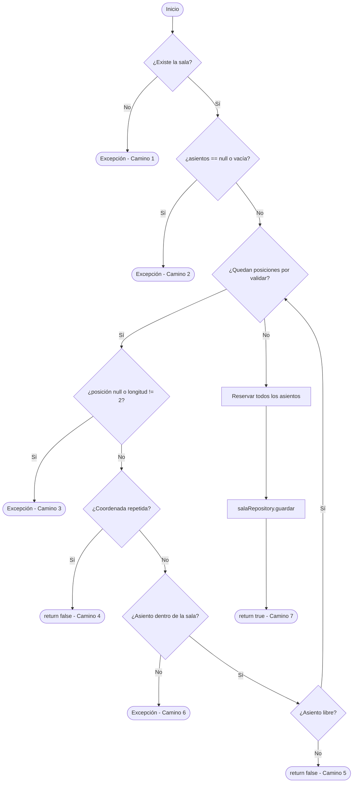
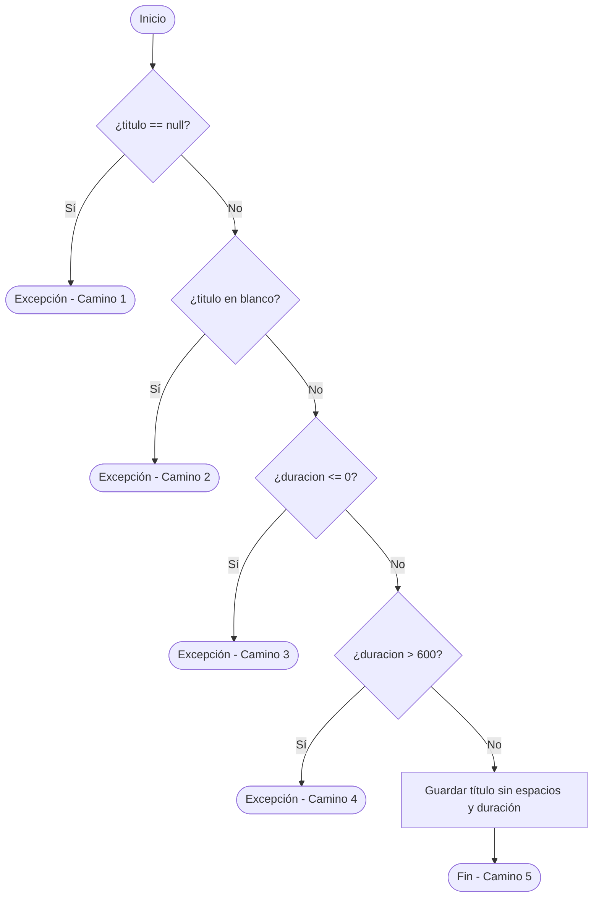
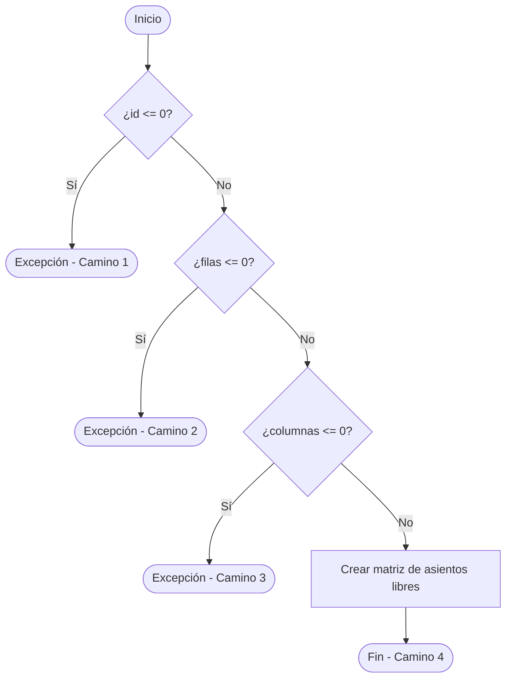

# Guía para el informe – SGRC (criterios para la nota máxima de 10)

Este documento relaciona cada criterio de evaluación con el código y los tests que lo cumplen,
para que sea fácil hacer las capturas y redactar el informe.

> **Eclipse + EclEmma:** los contratos usan `assert`, así que los tests deben ejecutarse con `-ea`.
> En Eclipse viene activado por defecto en *Preferences → Java → JUnit → "Add '-ea' to VM arguments..."*.
> Comprobadlo antes de hacer las capturas.
> En las líneas con `assert` EclEmma marca en **amarillo** una rama: es la rama "assert fallido"
> (o "asserts desactivados"), que no debe ejecutarse nunca. Comentadlo en el informe.

## 1. MVC

| Capa | Paquetes / clases |
|---|---|
| Model | `sgrc.modelo` (`Sala`, `Pelicula`), `sgrc.repositorio` (interfaces + implementaciones en memoria), `sgrc.servicio` (`ReservaService`, `CarteleraService`) |
| Controller | `sgrc.controlador.CineController` (solo conoce la interfaz `Vista`) |
| View | `sgrc.vista.Vista` (interfaz) y `sgrc.vista.ConsolaVista` (implementación por consola) |
| Arranque | `sgrc.Main` (solo cableado, sin lógica) |

El Controlador recibe la Vista por constructor, así se puede testear con un mock (`VistaMock` o Mockito)
sin consola. La Vista solo pinta datos y lee la entrada del usuario: no tiene lógica de negocio.
Puede leer `Sala` y `Pelicula` para mostrarlos, pero nunca los modifica.

`Main` hace el cableado y carga unos datos de ejemplo (3 películas y 3 salas) para que la aplicación
no arranque vacía:

```java
CineController controller = new CineController(carteleraService, reservaService, vista);
controller.iniciar();       // bucle principal: menú → opción → resultado
vista.mostrarDespedida();   // al elegir 0 (Salir)
```

Detalle de la Vista en el apartado 9.

## 2. TDD (≥ 90 % de métodos con ≥ 2 versiones de test y de código)

Los commits siguen el patrón `test(...): ... (TDD - Red)` → `feat(...): ... (TDD - Green)` → `refactor(...)`.
Métodos con al menos 2 versiones de test y de código (ver `git log --follow` del fichero):

| Clase | Métodos |
|---|---|
| `Sala` | constructor (validación de dimensiones → id → contratos), `estaAsientoDisponible`, `reservarAsiento`, `liberarAsiento`, `tieneAsientosDisponibles`, `contarAsientosLibres` |
| `Pelicula` | constructor (versión inicial → duración máxima → trim + contratos) |
| `PeliculaRepositoryImpl` | `guardar`, `buscarPorTitulo`, `eliminar` |
| `EnMemoriaSalaRepository` | `buscarPorId`, `guardar`, `obtenerSalasDisponibles` |
| `ReservaService` | constructor, `realizarReserva`, `realizarReservaMultiple`, `cancelarReserva` |
| `CarteleraService` | constructor, `agregarPelicula`, `eliminarPelicula` |
| `CineController` | constructor, `procesarOpcion` (6 ciclos Red/Green), `iniciar` |

Los getters y las delegaciones de una línea (`getFilas`, `obtenerTodas`, `obtenerSalas`...) son métodos simples
exentos de las 2 versiones según el enunciado.

## 3. Caja negra (clases de bajo nivel: `Sala`, `Pelicula`, `PeliculaRepositoryImpl`, `EnMemoriaSalaRepository`)

| Método | Particiones | Valores límite | Tests |
|---|---|---|---|
| `Sala(id, filas, columnas)` | id ≤ 0 / id > 0; filas ≤ 0 / > 0; columnas ≤ 0 / > 0 | id 0 y 1; filas 0 y 1; columnas 0 y 1 | `SalaTest.testConstructor*`, `SalaPairwiseTest` |
| `estaAsientoDisponible` | dentro/fuera; libre/ocupado | -1, 0, n-1, n en filas y columnas | `SalaTest`, `SalaDataDrivenTest` |
| `reservarAsiento` / `liberarAsiento` | libre/ocupado/fuera | última posición, fila = filas | `SalaTest` |
| `contarAsientosLibres` / `tieneAsientosDisponibles` | vacía / parcial / llena | sala 1x1 | `SalaTest`, `SalaLoopTest` |
| `Pelicula(titulo, duracion)` | null / "" / "   " / válido; ≤0 / [1,600] / >600 | 0, 1, 2, 599, 600, 601; título de 1 carácter | `PeliculaTest`, `PeliculaDataDrivenTest` |
| `PeliculaRepositoryImpl.*` | null / existente / inexistente / en blanco / mayúsculas / espacios | lista con 0, 1 y varias películas | `PeliculaRepositoryImplTest` |
| `EnMemoriaSalaRepository.*` | null / nueva / id duplicado / existente / inexistente | 0, 1, 2, n salas | `EnMemoriaSalaRepositoryTest` |

**Pairwise:** `SalaPairwiseTest` – constructor de `Sala` con 3 × 4 × 4 = 48 combinaciones reducidas a 16
que cubren todas las parejas (id, filas), (id, columnas) y (filas, columnas).

## 4. Programación por contrato (≥ 50 % de las clases del Model)

Precondiciones con `IllegalArgumentException`; postcondiciones e invariantes con `assert`.

| Clase | Pre | Post | Invariante |
|---|---|---|---|
| `Sala` | ✔ | ✔ | ✔ |
| `Pelicula` | ✔ | ✔ | ✔ |
| `EnMemoriaSalaRepository` | ✔ | ✔ | ✔ (sin ids repetidos) |
| `ReservaService` | ✔ | ✔ | ✔ (repositorio no nulo) |
| `CarteleraService` | ✔ | – | – |

Son 4 de 6 clases del Model con contratos completos (67 %).

## 5. Caja blanca

**Statement coverage:** 100 % de líneas en todo el código del Model y del Controlador
(captura de la pestaña *Coverage* de EclEmma o de `target/site/jacoco/index.html`).

**Decision + condition coverage (mínimo 3 métodos)**, con la tabla de verdad comentada en el test:

1. `Sala(int,int,int)` → `SalaTest.testConstructorDecisionConditionCoverage`
2. `Pelicula(String,int)` → `PeliculaTest.testConstructorDecisionConditionCoverage`
3. `Sala.estaAsientoDisponible` (4 condiciones) → `SalaDataDrivenTest` (cada condición true/false)
4. `ReservaService.realizarReservaMultiple` → `ReservaServiceTest` (tests de lista null/vacía y posición null/longitud 1/3)

**Path coverage (mínimo 2 métodos, con diagrama de flujo):** ver los diagramas de abajo.

**Loop testing (mínimo 2 simples y 2 anidados):**

| Bucle | Tipo | Tests |
|---|---|---|
| `EnMemoriaSalaRepository.buscarPorId` | simple | `EnMemoriaSalaRepositoryTest.testBuscarPorIdBucle*` (0, 1, 2, n, n sin encontrar) |
| `EnMemoriaSalaRepository.obtenerSalasDisponibles` | simple | `testObtenerSalasDisponiblesBucle*` / `TodasLlenas` / `UnaSala` |
| `CineController.iniciar` (while) | simple | `CineControllerVistaMockTest.testIniciar*` (1, 2, n) |
| `CineController.reservarVariosAsientos` (for) | simple | `CineControllerVistaMockTest.testReservaMultiple*` (0, 1, n) |
| `Sala.contarAsientosLibres` | anidado | `SalaLoopTest.testContarLibres*` |
| `Sala.tieneAsientosDisponibles` | anidado | `SalaLoopTest.testTieneDisponibles*` |

### Diagrama de flujo 1 – `ReservaService.realizarReservaMultiple`



| Camino | Test |
|---|---|
| 1 | `testReservaMultipleSalaNoExiste` |
| 2 | `testReservaMultipleListaNula`, `testReservaMultipleListaVacia` |
| 3 | `testReservaMultiplePosicionNula`, `...UnaCoordenada`, `...TresCoordenadas` |
| 4 | `testReservaMultipleCoordenadasDuplicadas` |
| 5 | `testReservaMultipleConAsientoOcupado` |
| 6 | `testReservaMultipleCoordenadasInvalidas` |
| 7 | `testReservaMultipleExitosa` |

### Diagrama de flujo 2 – constructor de `Pelicula`



Los 5 caminos se cubren en `PeliculaTest.testConstructorDecisionConditionCoverage` (casos A–E).

### Diagrama de flujo 3 – constructor de `Sala` (opcional, tercer método)



Caminos cubiertos en `SalaTest.testConstructorDecisionConditionCoverage` (casos A, B, C y D).

## 6. Automatización – data driven (mínimo 2 métodos de bajo nivel)

| Método | Test | Fichero de datos |
|---|---|---|
| `Sala.estaAsientoDisponible` | `SalaDataDrivenTest` | `src/test/resources/datos/sala_estaAsientoDisponible.csv` |
| Constructor de `Pelicula` | `PeliculaDataDrivenTest` | `src/test/resources/datos/pelicula_constructor.csv` |

## 7. Mock objects (> 4, > 50 % del Model, ≥ 2 manuales)

| # | Mock | Tipo | Simula | Capa probada | Test |
|---|---|---|---|---|---|
| 1 | `PeliculaRepository` | Mockito | repositorio de películas | Model | `CarteleraServiceTest` |
| 2 | `SalaRepository` | Mockito | repositorio de salas | Model | `ReservaServiceTest` |
| 3 | `Sala` | Mockito | sala | Model | `ReservaServiceSalaMockTest` |
| 4 | `SalaRepositoryMock` | **manual** | repositorio de salas | Model | `ReservaServiceMockManualTest` |
| 5 | `PeliculaRepositoryMock` | **manual** | repositorio de películas | Model | `CarteleraServiceMockManualTest` |
| 6 | `CarteleraService` | Mockito | servicio de cartelera | Controlador | `CineControllerTest` |
| 7 | `ReservaService` | Mockito | servicio de reservas | Controlador | `CineControllerTest` |
| 8 | `Vista` | Mockito | interacción con la Vista | Controlador | `CineControllerTest` |
| 9 | `VistaMock` | **manual** | interacción con la Vista | Controlador | `CineControllerVistaMockTest` |

Total 9 mocks: 5 para probar el Model (56 %) y 3 manuales.

## 8. CI/CD (GitHub Actions – `.github/workflows/maven.yml`)

- `mvn verify` se ejecuta en cada push a `main` y en cada Pull Request a `main`.
- **Calidad de código:** Checkstyle (`checkstyle.xml`): línea máxima de 120 caracteres, imports no usados,
  llaves obligatorias, tamaño de métodos, nombres camelCase... Cualquier violación hace fallar el build.
- **Cobertura:** JaCoCo genera el informe (artefacto `jacoco-report`) y hace fallar el build por debajo del 90 % de líneas.
  Se excluyen `sgrc/vista/**` y `sgrc/Main.class`: el enunciado no pide tests de la Vista y `Main` solo hace el cableado.
- **Bloqueo del merge:** regla de protección de `main` (Settings → Rules / Branches):
  *Require a pull request before merging* + *Require status checks to pass* con el check `build`.
  Haced una captura de esta configuración y de un PR bloqueado por un check en rojo.
- Cada funcionalidad se ha desarrollado en una rama `feature/...` fusionada a `main` mediante Pull Request.

## 9. Vista por consola (`ConsolaVista`)

El enunciado pide que la Vista esté desarrollada, pero no que se testee. Aun así tiene tests en
`ConsolaVistaTest`, y estos tests no cuentan para los criterios del Model ni del Controlador.

### Funcionalidades

| Método de `Vista` | Qué muestra o hace |
|---|---|
| `mostrarMenu` | La primera vez muestra el cartel de bienvenida. Después muestra el menú enmarcado y agrupado en *Cartelera* y *Salas y reservas*. Desde la segunda vez espera a que el usuario pulse Enter y limpia la pantalla antes de mostrarlo. |
| `leerOpcion` | Pide la opción. Si no es un número, avisa y la vuelve a pedir, en lugar de cerrar el programa con `NumberFormatException`. Después limpia la pantalla para que el resultado de la opción aparezca solo. Si se acaba la entrada (Ctrl+Z / Ctrl+D), devuelve 0 (Salir). |
| `leerEntero` / `leerTexto` | Muestran el mensaje con `»` y leen el dato. `leerEntero` vuelve a pedirlo si no es un número. |
| `mostrarMensaje` / `mostrarError` | Los mensajes salen con `►` por `System.out`. Los errores salen con `[!]` por `System.err`, y Eclipse los pinta en rojo. |
| `mostrarCartelera` | Tabla con número, título y duración, por ejemplo `195 minutos (3h 15min)`. Los títulos largos se recortan con `…`. Si no hay películas, muestra un aviso de cartelera vacía. |
| `mostrarSalas` | Tabla ordenada por número de sala con el tamaño (filas x asientos), los asientos libres y una barra de ocupación (`█░░░░░░░░░   8%`). Si no hay salas, muestra un aviso. |
| `mostrarSala` | Mapa de asientos con la pantalla, la numeración de asientos desde 1, `○` libre y `●` ocupado, una leyenda y el total de asientos libres. |
| `mostrarDespedida` | Mensaje de cierre. No forma parte de la interfaz `Vista`: lo llama `Main` al salir. |

Ejemplo del mapa de una sala:

```
           ═══════ PANTALLA ═══════
             1  2  3  4  5  6  7  8
  Fila  1 │  ●  ●  ○  ○  ○  ○  ○  ○ │
  Fila  2 │  ○  ○  ○  ○  ○  ○  ○  ○ │

  ○ libre   ● ocupado   ·   38 de 40 asientos libres
```

### Notas para el informe

- **Limpiar la pantalla:** en una terminal real se usa `cls` en Windows y la secuencia ANSI en Linux/macOS.
  La consola de Eclipse no deja que el programa la borre, así que allí el contenido anterior se aparta con líneas en blanco.
- **Colores:** son opcionales y se activan con `-Dsgrc.colores=true`, en *Run Configurations → Arguments → VM arguments*.
  Están desactivados por defecto porque Eclipse 2021-12 no interpreta los códigos ANSI.
- **Codificación:** los marcos usan caracteres Unicode y el proyecto está en UTF-8, así que en la consola de Eclipse se ven bien.
- **TDD en la Vista:** también se siguió el ciclo Red → Green (ver `git log --follow src/main/java/sgrc/vista/ConsolaVista.java`):
  1. Primera versión: menú, lecturas y mostrar salas y asientos, con un commit `test: RED ...` / `feat: GREEN ...` por método.
  2. Segunda versión: tablas, mapa de asientos y lectura robusta de números
     (`test(vista): ... (TDD - Red)` → `feat(vista): ... (TDD - Green)`).
  3. Tercera versión: limpiar la pantalla al elegir una opción y pausa antes de volver al menú.
- **Capturas recomendadas:** el menú inicial, la cartelera, el mapa de una sala después de reservar,
  un error (asiento ocupado o texto en lugar de número) y la despedida.
